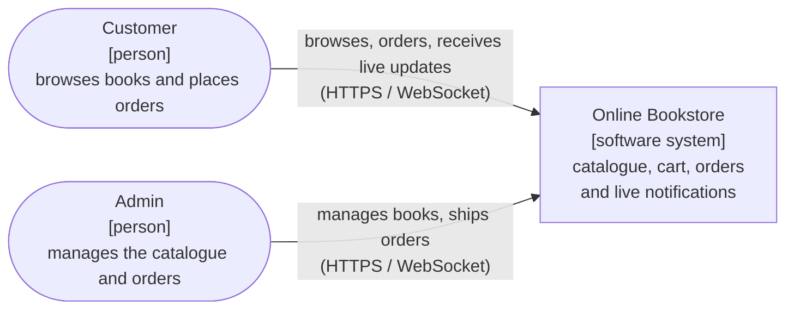
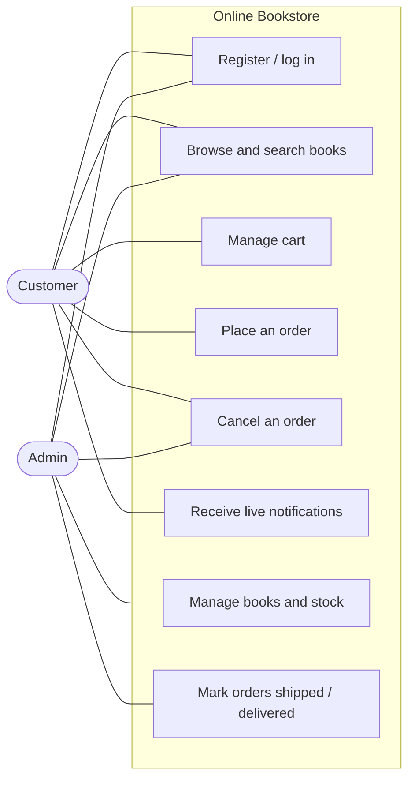

# 01 Overview

[Index](README.md) · [01 Overview](01-overview.md) · [02 Architecture](02-architecture.md) · [03 Communication](03-communication.md) · [04 Data model](04-data-model.md) · [05 API](05-api-reference.md) · [06 Design decisions](06-design-decisions.md)

## What the system does

The Online Bookstore is a web shop for books. Customers register, browse and search the catalogue, fill a cart and place orders. Admins manage the books and stock and move orders through shipping and delivery. When an order is placed, shipped, delivered or cancelled, the customer is told **in real time**: the notification appears in the browser without reloading the page.

The system is split into five independent microservices, each with its own data, behind an API gateway.

## Course requirements and how they are met

| Requirement                | How the project meets it                                                                                   |
| -------------------------- | ---------------------------------------------------------------------------------------------------------- |
| Microservices              | Five services: User, Catalog, Cart, Order and Notification (the API gateway is infrastructure, not counted) |
| Client                     | React + TypeScript web client with a customer area and an admin area                                       |
| Any programming language   | TypeScript (Node.js) for the backend and the client                                                        |
| Real-time communication    | WebSocket: the Notification Service pushes order notifications to the browser                              |
| Documentation in `docs/`   | This folder                                                                                                |
| Diagrams in Mermaid        | Every diagram in the repository is a Mermaid block; sources in [`diagrams/`](diagrams/)                    |

## Services

| Service              | Responsibility                                                              | Port (local) |
| -------------------- | --------------------------------------------------------------------------- | ------------ |
| **User Service**         | Registration and login, password hashing, issuing JWT tokens            | 3001         |
| **Catalog Service**      | Books, search, stock reservation and release                            | 3002         |
| **Cart Service**         | One cart per customer, checks books against the catalogue               | 3003         |
| **Order Service**        | Creates orders from carts, order lifecycle, publishes order events      | 3004         |
| **Notification Service** | Consumes order events, stores notifications, pushes them over WebSocket | 3005         |
| API Gateway          | Single entry point, JWT check, routing, WebSocket pass-through              | 3000         |
| Client               | Browser UI (React + Vite)                                                   | 5173         |

Why five: each service changes for a different reason and owns its own data. The boundaries follow the business areas (identity, products, shopping, ordering, messaging), which is how bounded contexts are usually found. Each service owns its data; no database is shared.

## Users

| Role         | Can do                                                                                                              |
| ------------ | ------------------------------------------------------------------------------------------------------------------- |
| **Customer** | Register and sign in, browse and search books, manage a cart, place orders, see **only their own** orders, cancel an order that has not shipped, receive notifications live |
| **Admin**    | Sign in, add, edit and delete books and set stock, see **all** orders, cancel orders, mark orders shipped and delivered |

## System context (C4 level 1)

Who uses the system and for what. The system is a single box at this level.

Source: [`diagrams/context.mmd`](diagrams/context.mmd)

There are no external systems. Payment and e-mail are out of scope; the Notification Service stores notifications and pushes them to the browser instead of sending real e-mail.

## Use cases

Source: [`diagrams/use-cases.mmd`](diagrams/use-cases.mmd)

| Use case          | Main flow                                                                                               |
| ----------------- | ------------------------------------------------------------------------------------------------------- |
| Buy books         | Log in → browse catalogue → add to cart → place order → see live confirmation                           |
| Cancel an order   | Open own order → cancel while `PLACED` → stock is released → notification arrives                      |
| Manage catalogue  | Admin logs in → adds or edits a book → sets stock                                                       |
| Fulfil an order   | Admin opens an order → marks it shipped → marks it delivered → customer is notified at each step        |

## Functional requirements

| ID   | Requirement                                                              | Actor           |
| ---- | ------------------------------------------------------------------------ | --------------- |
| F1   | Register and log in                                                      | Customer, Admin |
| F2   | Browse and search books                                                  | Anyone          |
| F3   | Add, edit and delete books, and set stock                                | Admin           |
| F4   | Add books to a cart, change quantities, remove items                     | Customer        |
| F5   | Place an order from the cart                                             | Customer        |
| F6   | View own orders; admins view all orders                                  | Customer, Admin |
| F7   | Cancel an order while it is still `PLACED`                               | Customer, Admin |
| F8   | Mark an order as shipped or delivered                                    | Admin           |
| F9   | Receive live notifications when an order is placed or changes status     | Customer        |

## Non-functional requirements

| Quality         | Target                                                                                  |
| --------------- | --------------------------------------------------------------------------------------- |
| Independence    | Each service has its own code, database and container; no shared database               |
| Resilience      | A failing Notification Service must not stop customers from placing orders              |
| Security        | Passwords hashed; JWT checked at the gateway; admin endpoints restricted by role        |
| Simplicity      | Whole system starts with one command: `docker compose up`                               |
| Testability     | Each service has its own automated tests                                                |

## Technology

| Concern              | Choice                                        | Why                                                                 |
| -------------------- | --------------------------------------------- | ------------------------------------------------------------------- |
| Backend              | Node.js 20, Express, TypeScript               | Small services with very little boilerplate; one language everywhere |
| Validation           | zod                                           | Request contracts checked in one place                              |
| Real-time            | WebSocket (`ws` library)                      | One persistent connection per browser; server pushes without polling |
| Messaging            | RabbitMQ (amqplib)                            | Topic exchange lets several services react to the same event        |
| Gateway              | Express + http-proxy-middleware               | Reverse proxy configured in code, also proxies WebSocket upgrades   |
| Authentication       | bcryptjs password hashes + JWT (HS256)        | Stateless; the gateway verifies the token once                      |
| Client               | React 18, Vite, TypeScript                    | Fast to set up, same language as the backend                        |
| Storage              | SQLite (better-sqlite3), one file per service | Each service owns its data; no shared database                      |
| Packaging            | Docker, Docker Compose                        | One command starts the whole system                                 |
| Tests                | Vitest, supertest                             | Integration tests per service and tests of the running system       |
| Documentation        | Markdown, Mermaid                             | Readable on GitHub, diagrams versioned as text                      |
