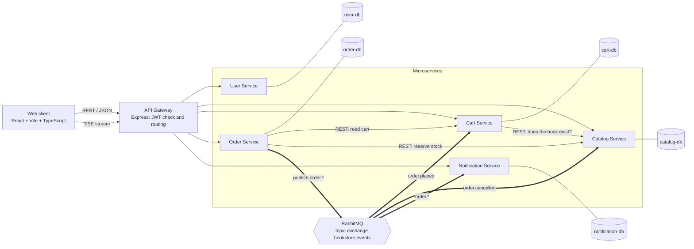
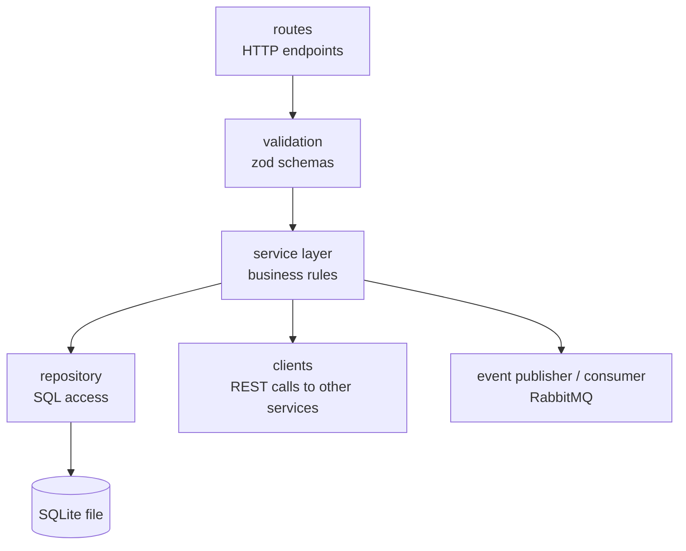
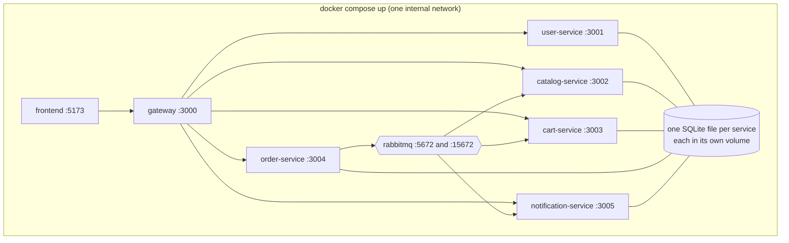

# 02 Architecture

## Container view



| Container            | Technology            | Responsibility                                       |
| -------------------- | --------------------- | ---------------------------------------------------- |
| Web client           | React, Vite           | UI for customers and admins; talks only to the gateway |
| API Gateway          | Express               | Single entry point, JWT verification, routing, SSE pass-through |
| User Service         | Express, SQLite       | Identity                                             |
| Catalog Service      | Express, SQLite       | Books and stock                                      |
| Cart Service         | Express, SQLite       | Carts                                                |
| Order Service        | Express, SQLite       | Orders and event publishing                          |
| Notification Service | Express, SQLite       | Event consumer and SSE stream                        |
| RabbitMQ             | Message broker        | Topic exchange `bookstore.events`                    |

## Component view of one service

All five services use the same internal layers, so they are easy to read and test.



## Deployment view



Only the gateway and the frontend are meant to be reached from outside. The services are not routed through the gateway for `/internal/*` paths, so internal endpoints cannot be called from the browser.

## Security model

| Concern              | Approach                                                                                          |
| -------------------- | ------------------------------------------------------------------------------------------------- |
| Passwords            | Hashed with bcrypt, never stored or logged in plain text                                          |
| Authentication       | User Service issues a signed JWT (user id, role, expiry); gateway verifies signature and expiry    |
| Passing identity     | Gateway adds `X-User-Id` and `X-User-Role` headers; services trust them because they are only reachable on the internal network |
| Authorization        | Role checks in the services (admin-only endpoints) and ownership checks (a customer sees only own orders) |
| Internal endpoints   | Paths under `/internal/` are never proxied by the gateway                                         |
| Input                | Every request body is validated with zod before use                                               |
| Secrets              | JWT secret and broker credentials come from environment variables, not from the repository        |

## Planned repository layout

```
project/
  docs/                  documentation and Mermaid diagrams
  gateway/               API gateway
  frontend/              React web client
  services/
    user-service/
    catalog-service/
    cart-service/
    order-service/
    notification-service/
  shared/                shared TypeScript types (event contracts)
  tests/                 end-to-end tests
  docker-compose.yml
```
