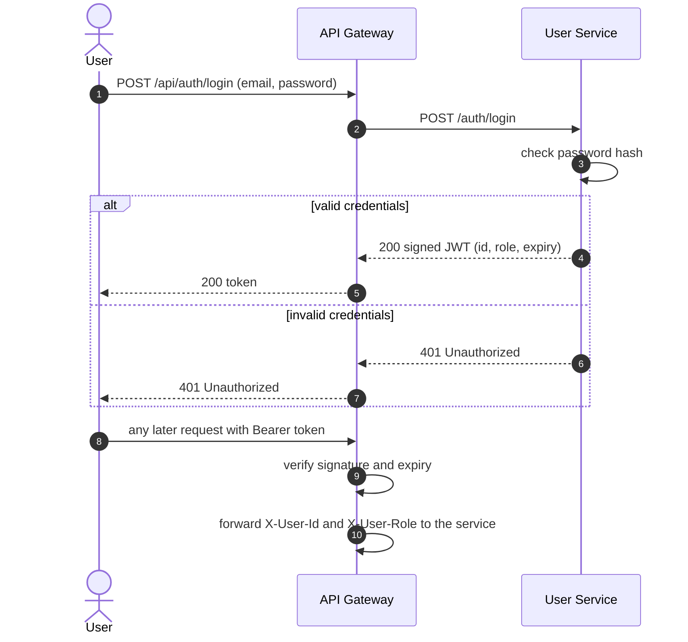
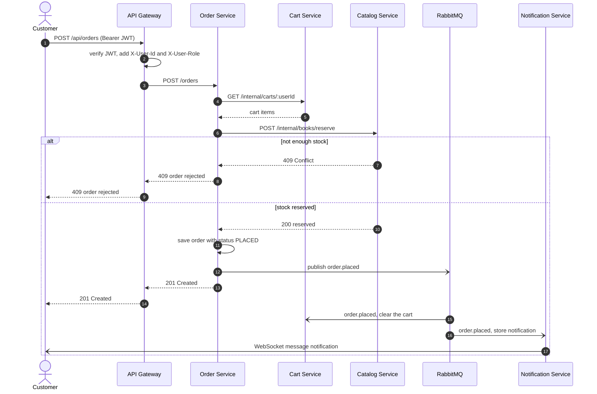
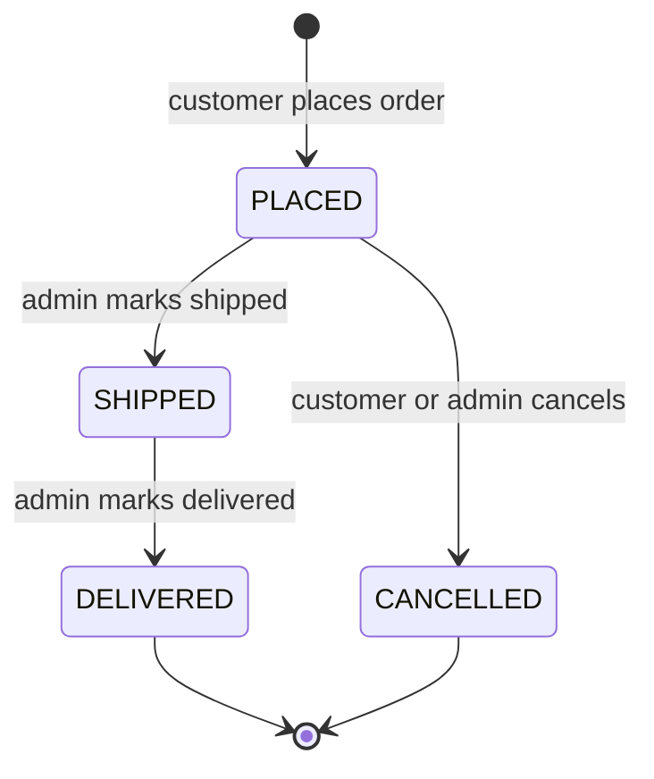

# 03 Communication

[Index](README.md) · [01 Overview](01-overview.md) · [02 Architecture](02-architecture.md) · [03 Communication](03-communication.md) · [04 Data model](04-data-model.md) · [05 API](05-api-reference.md) · [06 Design decisions](06-design-decisions.md)

## Which style where

| Interaction                          | Style        | Why                                                                  |
| ------------------------------------ | ------------ | -------------------------------------------------------------------- |
| Browser → gateway → services         | REST (sync)  | The user waits for the answer                                        |
| Cart → Catalog (does the book exist?) | REST (sync)  | The answer is needed before adding the item                          |
| Order → Cart (read the cart)         | REST (sync)  | Needed to build the order                                            |
| Order → Catalog (reserve stock)      | REST (sync)  | The order must be rejected immediately if stock is missing           |
| Order → everyone else ("order placed") | Event (async) | Order does not need to know who reacts; failures elsewhere must not block it |
| Notification → browser               | WebSocket (push) | Persistent connection, no polling; the server pushes as soon as an event arrives |

## Login and authenticated requests



## Placing an order



The calls to the Cart and Catalog services are synchronous: the customer gets an answer only after stock was reserved. After the order is saved, everything else is asynchronous. If RabbitMQ or the Notification Service is down at that moment, the order is still valid.

## Order lifecycle



Every transition publishes an event with the routing key `order.placed`, `order.shipped`, `order.delivered` or `order.cancelled`.

## Events

Exchange: `bookstore.events` (topic, durable).

| Routing key        | Published by  | Consumed by                                         | Reaction                                  |
| ------------------ | ------------- | --------------------------------------------------- | ----------------------------------------- |
| `order.placed`     | Order Service | Cart Service, Notification Service                  | Clear the cart; create "order placed" notification |
| `order.shipped`    | Order Service | Notification Service                                | Create notification                       |
| `order.delivered`  | Order Service | Notification Service                                | Create notification                       |
| `order.cancelled`  | Order Service | Catalog Service, Notification Service               | Release reserved stock; create notification |

Each consumer has its own durable queue (for example `cart.order-placed`, `notification.orders`). The Notification Service binds with `order.*`.

## Live notifications (WebSocket)

1. After login, the web client opens `ws://localhost:3000/api/notifications/ws?access_token=<JWT>`.
2. The gateway checks the token, then proxies the WebSocket upgrade to the Notification Service.
3. The Notification Service keeps a map from user id to open sockets. When it stores a notification, it sends a JSON message to every open socket of that user.
4. Heartbeat: the server sends a ping every 30 seconds. A socket that does not answer with a pong is closed.
5. Reconnect: if the connection drops, the client reconnects with a growing delay (1 s, 2 s, 4 s, up to 30 s).
6. Resynchronisation: after reconnecting, the client loads missed notifications with `GET /api/notifications` and merges them by id, because messages sent while it was offline are not replayed on the socket.

Browsers cannot set an `Authorization` header on a WebSocket, so for this one route the token is sent as the query parameter `access_token`.

Message from server to client:

```json
{ "type": "notification", "data": { "id": "uuid", "kind": "order.placed", "message": "Your order was placed", "createdAt": "2026-10-24T12:00:00Z" } }
```

## Failure behaviour

| Situation                                   | Behaviour                                                                                   |
| ------------------------------------------- | ------------------------------------------------------------------------------------------- |
| Catalog Service is down during checkout     | Order Service times out (3 s), returns `503`; no order is created                           |
| Cart Service is down during checkout        | Same: `503`, nothing is saved                                                               |
| Order saved but event cannot be published   | Order stays valid; event is retried from a small outbox table in the Order database         |
| Notification Service is down                | Messages wait in its queue and are processed when it returns                                |
| Same event delivered twice                  | Consumers store processed event ids and ignore duplicates (idempotent)                      |
| A message keeps failing                     | After 3 attempts it moves to a dead-letter queue for inspection                             |
| Order save fails after stock was reserved   | Order Service calls `POST /internal/books/release` to undo the reservation                  |
| Slow downstream call                        | Every service-to-service call has a timeout; no unbounded waiting                           |
| WebSocket connection drops                  | Client reconnects with backoff and reloads missed notifications through the REST endpoint |
