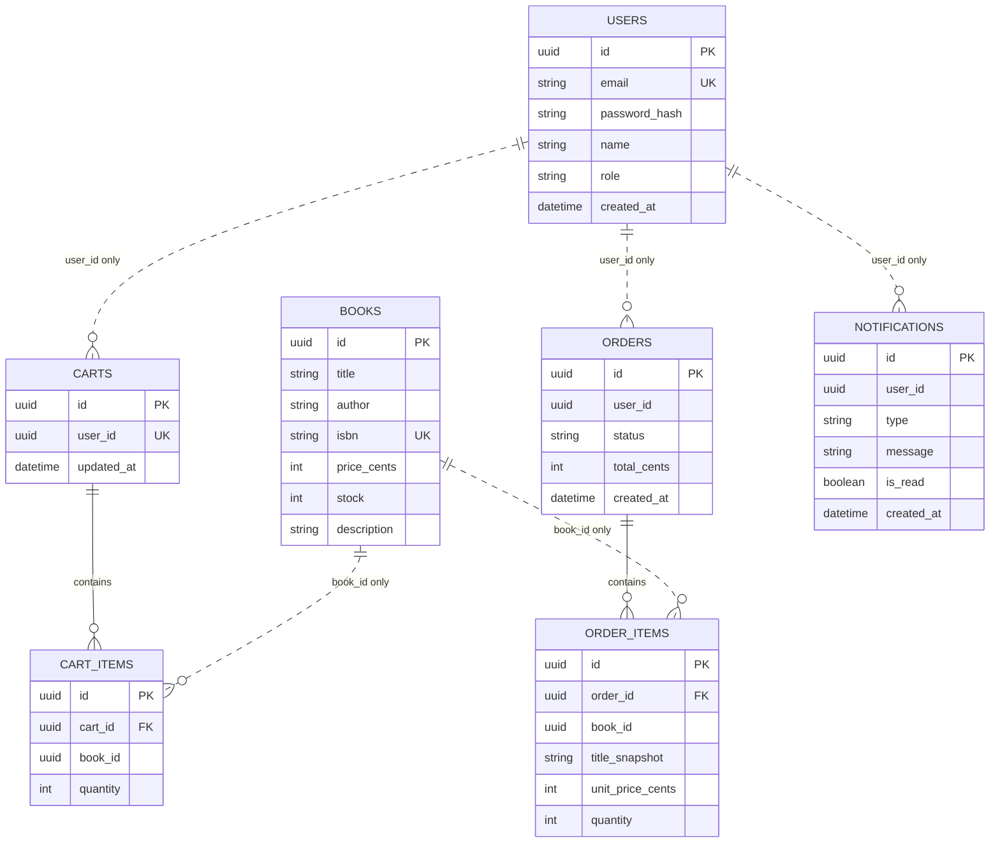

# 04 Data model

## ER diagram



Solid relationships exist inside one service. Dotted relationships cross a service boundary: there is **no foreign key and no join** between databases, only an id stored as a plain value.

## Data owned by each service

| Service              | Tables                         | Notes                                                                 |
| -------------------- | ------------------------------ | --------------------------------------------------------------------- |
| User Service         | `users`                        | Only this service reads or writes user records                        |
| Catalog Service      | `books`, `processed_events`    | `stock` is changed only here                                          |
| Cart Service         | `carts`, `cart_items`, `processed_events` | Stores book ids and quantities, not prices                  |
| Order Service        | `orders`, `order_items`, `outbox` | Items keep a snapshot of title and price at purchase time          |
| Notification Service | `notifications`, `processed_events` | Stores what was shown to the user                                |

Why `order_items` keeps `title_snapshot` and `unit_price_cents`: a later price change or book deletion must not rewrite order history.

## Message contracts

All events share an envelope.

```json
{
  "eventId": "uuid",
  "type": "order.placed",
  "occurredAt": "2026-10-24T12:00:00Z",
  "data": { }
}
```

`order.placed` data:

```json
{
  "orderId": "uuid",
  "userId": "uuid",
  "totalCents": 4590,
  "items": [{ "bookId": "uuid", "quantity": 2 }]
}
```

`order.shipped`, `order.delivered`: `{ "orderId", "userId" }`.
`order.cancelled`: `{ "orderId", "userId", "items": [{ "bookId", "quantity" }] }` (items are needed so the Catalog Service can restock).

Internal request `POST /internal/books/reserve`:

```json
{ "items": [{ "bookId": "uuid", "quantity": 2 }] }
```

The reservation is all-or-nothing: if one book lacks stock, nothing is reserved.

## Validation rules

| Field               | Rule                                                           |
| ------------------- | -------------------------------------------------------------- |
| `email`             | Valid format, unique                                           |
| `password`          | At least 8 characters                                          |
| `role`              | `CUSTOMER` or `ADMIN`; new users are always `CUSTOMER`         |
| `title`, `author`   | Non-empty, at most 200 characters                              |
| `isbn`              | Unique                                                         |
| `price_cents`       | Integer, 0 or more (money is never stored as a float)          |
| `stock`             | Integer, 0 or more; never goes below 0                         |
| `quantity`          | Integer, at least 1                                            |
| order `status`      | One of `PLACED`, `SHIPPED`, `DELIVERED`, `CANCELLED`; only the transitions in the state diagram are allowed |
