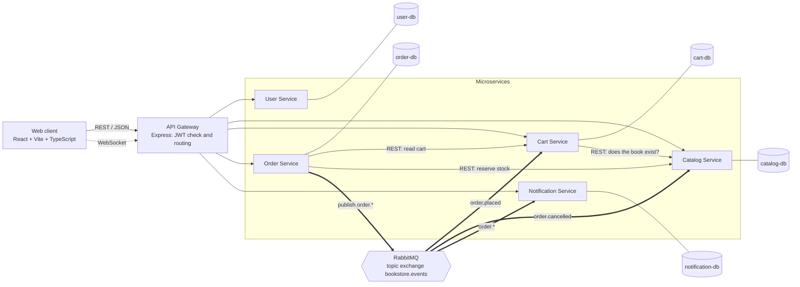

# Documentation index

| Page | Contents |
| ---- | -------- |
| [01 Overview](01-overview.md) | Requirements, system context, services, use cases, technology |
| [02 Architecture](02-architecture.md) | Container and component views, deployment, security model |
| [03 Communication](03-communication.md) | Synchronous and asynchronous flows, login, WebSocket, failure behaviour |
| [04 Data model](04-data-model.md) | ER diagram, data owned by each service, message contracts, validation |
| [05 API reference](05-api-reference.md) | Gateway routing, endpoints with access rules, events |
| [06 Design decisions](06-design-decisions.md) | Decisions, known limitations, likely questions |

## High-level architecture

Solid arrows are synchronous REST calls. Thick arrows are asynchronous events through RabbitMQ. The dotted arrow is the long-lived WebSocket connection to the browser.
